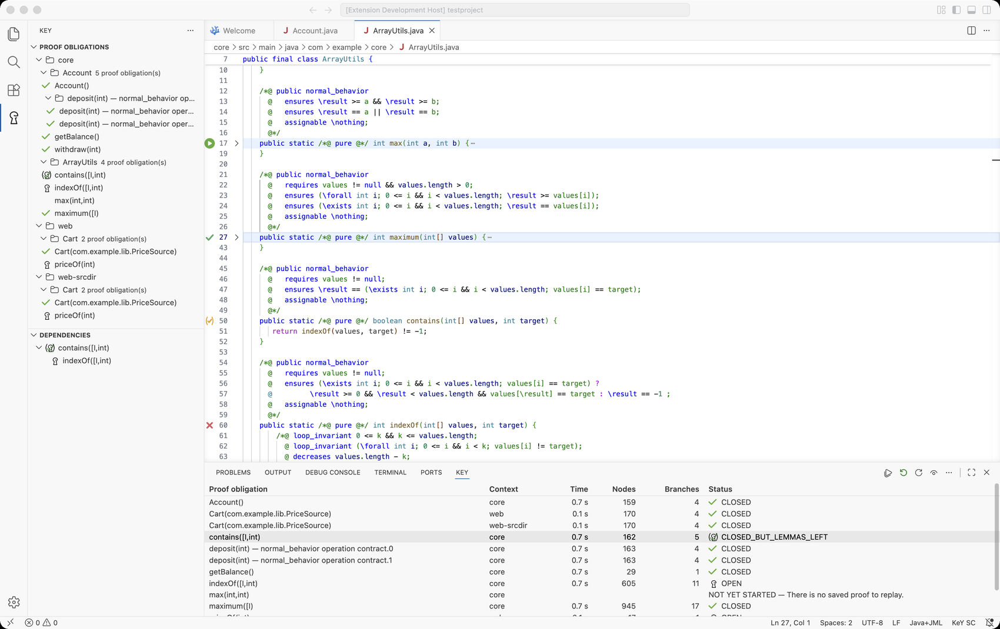
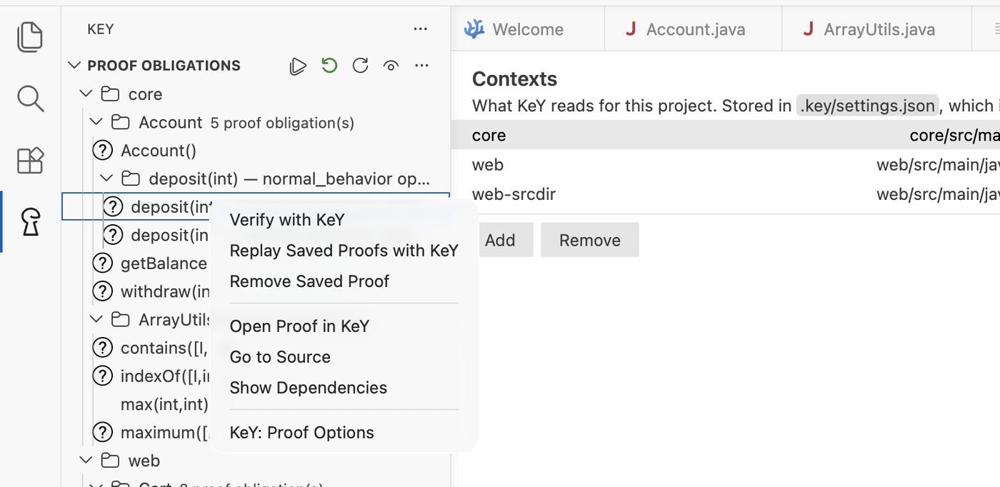
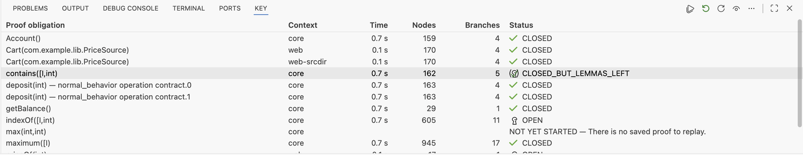
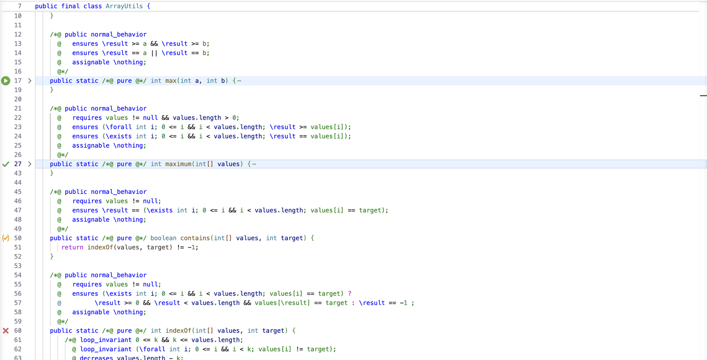

# The interface

This page describes the views, commands, marks and icons the extension adds.

## The views

The KeY icon in the activity bar opens two panes, **Proof Obligations** and
**Dependencies**. The **Verification** table is in the bottom panel, next to the terminal.

All KeY panes have the same toolbar.

### Proof Obligations

All proof obligations of the project, grouped by context, class and method. A method with
several specification cases has one row per case. Selecting a row opens its source.

The buttons and the context menu of a row apply to all selected rows:

| Action | What it does |
|---|---|
| **Verify Proof Obligations** | proves them without opening KeY's window |
| **Replay Saved Proofs** | replays the saved proofs and reports their status |
| **Remove Saved Proof** | deletes the proof files after a confirmation |
| **Open Proof in KeY** | opens the proof in a KeY window |
| **Go to Source** | opens the declaration the contract belongs to |
| **Show Dependencies** | shows the contracts the proof uses in the Dependencies pane |
| **KeY: Proof Options** | edits the taclet and strategy options for the selection |

The toolbar has **Verify Everything**, **Replay Every Saved Proof**, **Verify on Save** and
**Refresh**, and a menu with the project's proof options, the prover, the contexts, the
trash and **Restart KeY**.

The **Verify on Save** button shows an open eye when verification on save is on, and a
closed eye when it is off.

### Verification

A table with one row per proof obligation:

| Column | What it shows |
|---|---|
| Proof obligation | the method of the contract; if the method has several contracts, also the kind of contract |
| Time | the duration of the last attempt; empty if nothing was measured |
| Nodes, Branches | the size of the proof |
| Status | the status with KeY's icon, followed by the error message if the attempt failed |

The rows are grouped by class, under a header with the class name and its number of proof
obligations. Click a header's arrow, or double-click the header, to fold the group. Select a
header to act on the whole class. With several contexts, the header also shows the context.

Click a heading to sort the rows within each class; the third click restores the listing
order. Rows with no measurement sort last either way. Click a row to select it, ⌘-click or
shift-click to select several, double-click to open the source, and right-click for the
context menu with the same actions as in the other views.

If a saved proof was created with settings that differ from the current configuration, the
status cell shows a **settings differ** link. It lists the differing settings and offers to
open the saved proof or to prove it again with the current settings.

When it is first shown, the table lists all obligations of the project. **KeY: Clear the
Verification View** empties it.

### Dependencies

The contracts a proof uses, as reported by KeY, and the contracts those proofs use in turn.
**Show Dependencies** fills the pane. **Verify Dependencies** in its title bar proves the
contracts that are not proved yet.

## Marks in the gutter

The gutter shows a mark next to every method with a contract and next to its class:

| Mark | What it means |
|---|---|
| { width="18" } | all proof obligations of the method are closed |
| { width="18" } | closed, but the proof uses contracts that are not proved |
| { width="18" } | at least one obligation has open goals |
| { width="18" } | no obligation has a result yet |

The mark of a class is the weakest mark of its methods, so it is green only when all
obligations of the class are proved.

Gutter marks in VS Code cannot be clicked. The actions **Verify with KeY**, **Replay** and
**Open proof** are shown above each marked declaration instead; `key.codeLens` turns them
off. The tooltip of a marked line explains the mark and contains the same actions as links.

## Status icons

The panes use KeY's own status icons, loaded from the configured KeY jar:

| Icon | State | Meaning |
|---|---|---|
| { width="18" } | `OPEN` | the proof has open goals |
| { width="18" } | `CLOSED_BUT_LEMMAS_LEFT` | proved, but the proof uses contracts that are not proved |
| { width="18" } | `CLOSED` | proved |
| { width="18" } | `CLOSED_BY_CACHE` | proved, reusing a cached proof |
| { width="18" } | `SAVED` | a proof is saved but has not been replayed against the current sources |
| nothing | `NONE` | no proof exists for this contract |

The continue icon, { width="18" }, is not a state. It
marks obligations without a result.

`SAVED` and `UNKNOWN` share KeY's question-mark icon, which KeY draws dark. The bridge
provides a light variant, { width="18" }, and a dark
variant, { width="18" }. The editor shows the one
that matches its theme.

## The status bar

`KeY SC` or `KeY MT 4x` shows the project's prover. Clicking it runs **KeY: Select Single
Core or Multi-Core Prover**, which selects the single-threaded prover or the multi-threaded
prover with a number of workers. The toolbar button switches between the two directly.

## Commands

All commands are in the command palette under **KeY**:

| Command | What it does |
|---|---|
| **Verify with KeY** | proves the obligations of the method at the cursor, or of the whole file if the cursor is outside a method |
| **Replay Saved Proofs with KeY** | replays the saved proofs of the selection |
| **Verify Dependencies** | proves the contracts the shown proof uses that are not proved yet |
| **KeY: Verify Everything** | proves all obligations of all contexts |
| **KeY: Replay Every Saved Proof** | replays all saved proofs |
| **KeY: Refresh** | reloads the list of proof obligations |
| **KeY: Proof Options of the Project** | edits the project's proof options |
| **KeY: Select Single Core or Multi-Core Prover** | selects the prover and the number of workers |
| **KeY: Switch Between Single Core and Multi-Core Prover** | switches between the two provers; the toolbar button runs it |
| **KeY: Clear the Verification View** | empties the table |
| **KeY: Empty the Trash of Replaced Proofs** | applies the trash policy now |
| **KeY: Clean Up Settings of Proof Obligations That No Longer Exist** | removes the settings of proof obligations that no longer exist, for example after a method was renamed |
| **KeY: Edit Contexts** | edits the contexts KeY loads |
| **KeY: Validate Configuration** | checks the paths without starting KeY |
| **KeY: Open Configuration File** | opens `.key/settings.json` |
| **KeY: Restart KeY** | restarts the bridge and KeY |
| **KeY: Stop** | stops the bridge and KeY; the next request starts them again |

## Notifications and progress

A run is shown as a progress notification and can be cancelled. Proofs completed before
cancelling are kept. When the run ends, a notification reports how many obligations were
proved and which remain open. The **KeY** output channel contains KeY's log; check it when
something fails.
