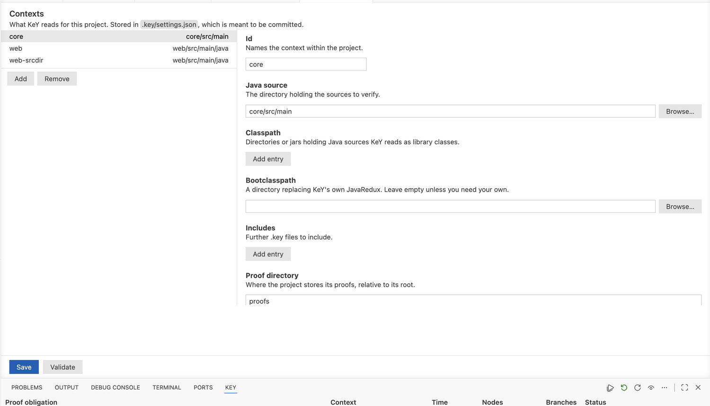
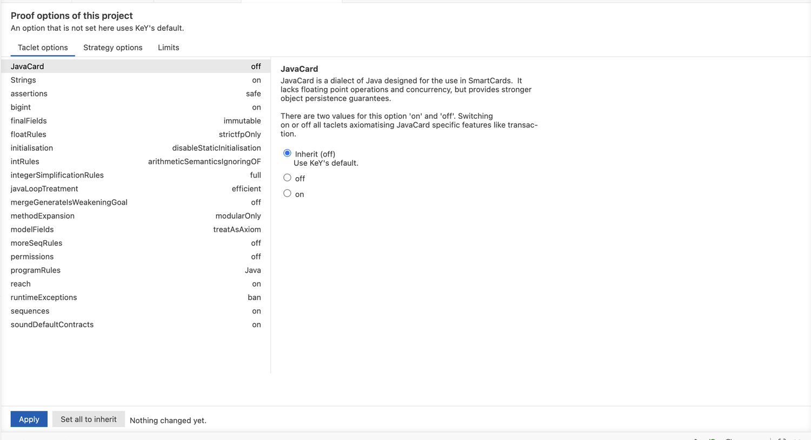
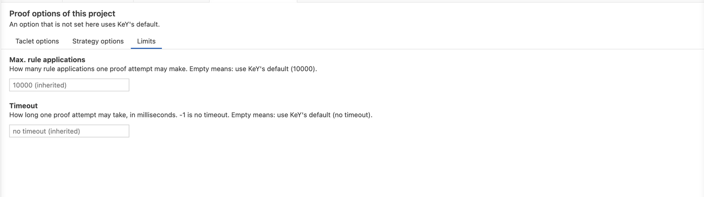

# Settings

Settings are stored in two places: in the editor settings, per user, and in
`.key/settings.json`, per project.

## Editor settings

| Setting | Meaning |
|---|---|
| **key.keyJar** | the `key-*-exe.jar` the extension starts |
| **key.bridgeJar** | the `key-ide-common-*-all.jar` the extension starts with it |
| **key.javaHome** | the JDK, 21 or later, that runs KeY and the bridge. If empty, `JAVA_HOME` is used, then `java` from the path |
| **key.keyHome** | the directory for KeY's settings, logs and caches: **project** (`.key/tool`), separate for each project and starting with KeY's defaults, or **user** (`~/.key`), shared with KeY started outside the editor |
| **key.verifyOnSave** | on saving, replays the saved proofs of the context and proves the obligations the edit broke or added. On by default |
| **key.proofWindow** | where **Open Proof in KeY** opens a proof: **reuse** opens all proofs in one KeY window, **new** opens a window for each proof. Only windows opened by the extension are reused |
| **key.codeLens** | shows **Verify with KeY**, **Replay** and **Open proof** above each declaration with a contract. On by default |
| **key.trashPolicy** | what happens to proofs replaced by a new run: **never** keeps all, **emptyOnStart** deletes all when a window opens, **belowSize** deletes the oldest until the trash is below `key.trashMegabytes`, **olderThan** deletes those older than `key.trashDays` |
| **key.trashMegabytes** | the maximum size of the trash in megabytes, for `belowSize` |
| **key.trashDays** | the age in days at which a replaced proof is deleted, for `olderThan` |
| **key.transport** | the connection to the bridge: **auto** uses the platform's default, **tcp** uses a loopback TCP port |

Replaced proofs are moved to `proofs/.trash`, where a previous proof can be restored by hand.
The trash policy is applied when a window opens.

!!! note
    `key.transport` rarely needs changing. On Windows the extension uses a loopback TCP port
    automatically.

## The project file

`.key/settings.json` is written by **KeY: Edit Contexts** or by hand. Commit it with the
project.

**KeY: Edit Contexts** opens a form with the list of contexts on the left and the selected
context on the right. Paths can be typed or chosen with a file picker. Saving validates the
entries and shows each problem at its field.

A **context** is a set of paths that KeY loads together:

| Field | Meaning |
|---|---|
| **id** | the name of the context, unique within the project |
| **javaSource** | the directory with the sources to verify |
| **classpath** | entries with Java sources that KeY loads as library classes |
| **bootclasspath** | a directory that replaces KeY's built-in JavaRedux library classes |
| **includes** | additional `.key` files to include |

Paths inside the project are stored relative to it. **proofDirectory** sets where proofs are
saved, `proofs` by default.

## Proof options

Proof options can be set at three levels: the project, a context and a single proof
obligation. A context inherits from the project, and an obligation from its context. Each
level stores only the options it changes. An option set at no level has KeY's default value.

The form has a tab for each kind of option:

- **Taclet options**: choices from KeY's rule files, for example how method calls are
  treated. They change what is proved.
- **Strategy options**: settings of the proof search, for example loop treatment or
  arithmetic. They affect how long a proof takes, not its meaning.
- **Limits**: **Max. rule applications**, the maximum number of rule applications of one
  attempt, and **Timeout**, the maximum duration of one attempt in milliseconds; `-1` means
  no timeout. An empty field inherits the value of the level above.

Each tab lists its options on the left with their current values; options set at this level
are marked. The selected option is edited on the right, with its description and its
allowed values. Every option offers **Inherit** in addition to its values and shows the
value it would inherit. **Set all to inherit** resets the whole form.

Only changed options are saved. When several obligations are edited at once, each keeps the
options that were not changed. If the selected obligations have different values for an
option, the form shows it as unset, and leaving it unchanged keeps the individual values.

Run **KeY: Proof Options of the Project** for the project, or **KeY: Proof Options** on rows
of the **Proof Obligations** pane for contexts or single obligations. The options are shown
with KeY's names and descriptions, as in KeY's own dialogs.

## The prover

The prover is selected per project in the status bar and in the KeY toolbar: **SC** for the
single-threaded prover, or **MT** with a number of workers for the multi-threaded prover.
The choice applies to all proofs of the project.
